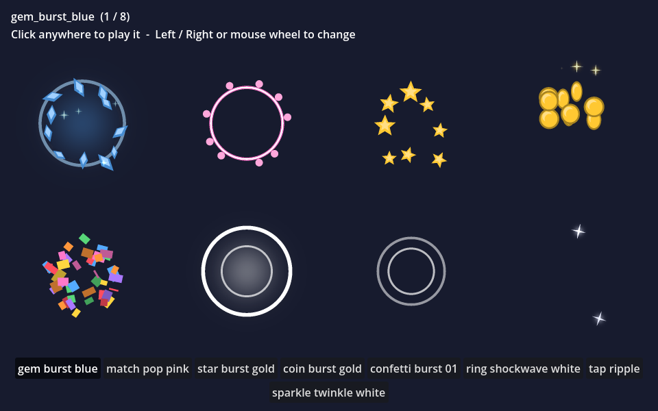

# Crisp Juice Free

Eight sprite-sheet effects for casual and puzzle games - gem burst, match pop, star burst, coin burst, confetti,
shockwave ring, tap ripple and a looping sparkle - as ready-to-use Godot 4 scenes, plus `CrispVfx`, a small script that
plays a sheet and frees the node when it is done. It is the free sampler of [Crisp Juice](https://anipixels.itch.io/crisp-juice).



## Install

**From the Asset Library (inside Godot):** open the **AssetLib** tab, search for "Crisp Juice Free", press **Download**, then **Install**.
Everything lands in `res://addons/crisp_juice_free/`.

**By hand:** download this repository (or `git clone` it) and copy the `addons/crisp_juice_free` folder into your project,
so that it sits at `res://addons/crisp_juice_free`. The scenes and resources point at that path, so keep the folder name.

To try the demo, open `res://addons/crisp_juice_free/demo/vfx_demo.tscn` and press **Run Current Scene** (F6).
A `git clone` of this repository also opens as a Godot project of its own and runs the demo with F5
(zip downloads leave `project.godot` out on purpose, so they contain only the `addons/` folder).

## Use

Drag any scene from `addons/crisp_juice_free/scenes` into your level: it plays as soon as it appears and removes itself when it finishes.
Or spawn one from code:

```gdscript
const BURST := preload("res://addons/crisp_juice_free/scenes/gem_burst_blue.tscn")

func _on_gem_matched(gem: Node2D) -> void:
    CrispVfx.spawn(BURST, self, gem.position)        # scene, parent, position in the parent's space
    CrispVfx.spawn(BURST, self, gem.position, 0.5)   # optional 4th argument: scale
```

Each scene is one `Sprite2D` with the `CrispVfx` script. In the Inspector you can change `fps`, `loop`, `autoplay` and
`free_on_finish`; call `play()` / `stop()` to reuse a node, and connect to the `finished` signal to chain things.
`sparkle_twinkle_white_loop` loops until you free it. The sheets are plain PNG grids, so they also work in an
`AnimatedSprite2D` or outside Godot (`sheets.json` lists frame count, cell size, columns and rows).

## What is in it

| Effect | Category | Frames | Cell | Loops | Blend |
|---|---|---|---|---|---|
| `gem_burst_blue` | Gems | 20 | 192 px | no | normal |
| `match_pop_pink` | Gems | 16 | 192 px | no | normal |
| `star_burst_gold` | Rewards | 24 | 192 px | no | normal |
| `coin_burst_gold` | Rewards | 30 | 256 px | no | normal |
| `confetti_burst_01` | Celebration | 36 | 256 px | no | normal |
| `ring_shockwave_white` | Impacts | 16 | 192 px | no | normal |
| `tap_ripple` | Impacts | 14 | 192 px | no | normal |
| `sparkle_twinkle_white_loop` | Magic | 24 | 192 px | yes | additive |

All sheets are drawn for 30 frames per second, with straight alpha. Files (22, 1.03 MB):

- `./` - `LICENSE.txt`, `README.md`, `crisp_vfx.gd`, `sheets.json`
- `demo/` - `vfx_demo.gd`, `vfx_demo.tscn`
- `scenes/` - `coin_burst_gold.tscn`, `confetti_burst_01.tscn`, `gem_burst_blue.tscn`, `match_pop_pink.tscn`, `ring_shockwave_white.tscn`, `sparkle_twinkle_white_loop.tscn`, `star_burst_gold.tscn`, `tap_ripple.tscn`
- `sheets/` - `coin_burst_gold.png`, `confetti_burst_01.png`, `gem_burst_blue.png`, `match_pop_pink.png`, `ring_shockwave_white.png`, `sparkle_twinkle_white_loop.png`, `star_burst_gold.png`, `tap_ripple.png`

`CrispVfx` is registered with `class_name`. If you later install the full pack, delete this folder first: the full pack
contains these eight effects too and defines the same class name.

## Full pack

**[Crisp Juice on itch.io](https://anipixels.itch.io/crisp-juice)** has **68 effects** - these 8 and 60 more, in six categories: Gems (30: gem bursts, match pops,
tileable horizontal and vertical line blasts), Rewards (10: coins, stars), Celebration (7: confetti, fireworks, a tileable falling
confetti loop), Impacts (8), Magic (6) and Highlights (7 loops). Same sheet format and the same `CrispVfx` script.

## Godot version

Written for **Godot 4.3 and newer** (GDScript only, no C#, no GDExtension, no feature known to need 4.4 or later).
Tested on **Godot 4.7.2 stable (the .NET editor build, run headless on Windows 11)**: headless import plus a script that loads every file and exercises the public API,
with no errors or warnings. It has **not** been run on 4.3 - 4.6; if something misbehaves there, please open an issue.

## Licence

This free repository has two licences, both standard and both fine for commercial games:

- **Assets** - the sprite sheets (PNG), scenes (.tscn) and sheets.json - are under **Creative Commons Attribution 4.0 International (CC BY 4.0)**.
  Use, edit and ship them in anything, including commercial projects, as long as you give credit.
  A line like this in your credits is enough: `Crisp Juice Free by Anipixels - https://anipixels.itch.io/crisp-juice`
- **Code** - every `.gd` file - is under the **MIT licence**.

See `LICENSE` (assets) and `LICENSE-CODE` (code); a copy of both is in `addons/crisp_juice_free/LICENSE.txt`.
This applies to the files in this repository only. The paid full pack has its own licence (no attribution needed, no redistribution).

## How it was made

The sprite sheets are generated procedurally by code written with an AI assistant (Claude). No AI image or audio generators were used, and nothing is traced or taken from third-party assets.
